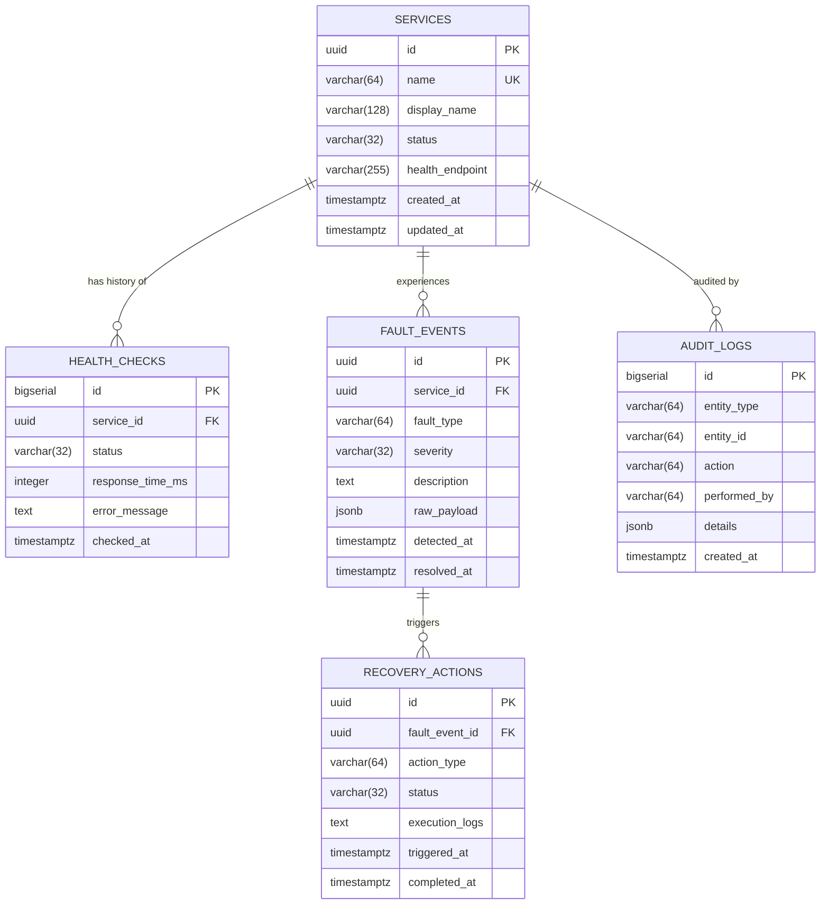

# AutoHeal AI — Database Design & Schema Specification
**Phase 2: Relational Architecture, Data Model, and Flyway Migrations**  
**Document Version:** 1.0.0  
**Database Engine:** PostgreSQL 16 Alpine  
**Migration Engine:** Flyway 10 Alpine  

---

## 1. Overview & Objectives

AutoHeal AI requires a robust, relational audit trail to record microservice operational states, detect anomalies, orchestrate autonomous recovery actions, and preserve complete security audit logs. 

The database architecture provides:
- **ACID transactional integrity**: Preventing split-brain recovery attempts.
- **Relational auditability**: Linking recovery actions directly to triggering fault events and affected services.
- **Automated migrations**: Zero manual SQL script execution; Flyway applies versioned scripts sequentially upon cluster launch.
- **Index-optimized queries**: Ensuring rapid health polling, event correlation, and diagnostic telemetry analysis.

---

## 2. Entity-Relationship Diagram (ERD)

---

## 3. Schema Specifications

### 3.1 `services`
The registry of all managed components in the AutoHeal cluster.

| Column | Type | Constraints | Description |
|---|---|---|---|
| `id` | `UUID` | `PRIMARY KEY DEFAULT gen_random_uuid()` | Unique immutable identifier |
| `name` | `VARCHAR(64)` | `UNIQUE NOT NULL` | Machine-readable identifier (e.g., `web-service`) |
| `display_name` | `VARCHAR(128)` | `NOT NULL` | Human-readable title |
| `status` | `VARCHAR(32)` | `NOT NULL DEFAULT 'UNKNOWN'` | Current consensus health (`UP`, `DOWN`, `DEGRADED`) |
| `health_endpoint`| `VARCHAR(255)` | `NULLABLE` | HTTP path probed by health collectors (e.g., `/health`) |
| `created_at` | `TIMESTAMPTZ` | `NOT NULL DEFAULT CURRENT_TIMESTAMP` | Registration timestamp |
| `updated_at` | `TIMESTAMPTZ` | `NOT NULL DEFAULT CURRENT_TIMESTAMP` | Last updated timestamp (updated via trigger) |

### 3.2 `health_checks`
Time-series log of active health probes conducted by the monitoring engine.

| Column | Type | Constraints | Description |
|---|---|---|---|
| `id` | `BIGSERIAL` | `PRIMARY KEY` | Incremental row ID |
| `service_id` | `UUID` | `NOT NULL REFERENCES services(id) ON DELETE CASCADE` | Affected service |
| `status` | `VARCHAR(32)` | `NOT NULL` | Probe status (`UP`, `DOWN`, `TIMEOUT`) |
| `response_time_ms`| `INTEGER` | `NULLABLE` | Round-trip latency in milliseconds |
| `error_message` | `TEXT` | `NULLABLE` | Error or stack trace if probe failed |
| `checked_at` | `TIMESTAMPTZ` | `NOT NULL DEFAULT CURRENT_TIMESTAMP` | Probe timestamp |

**Indices:**
- `idx_health_checks_service_checked`: Composite index on `(service_id, checked_at DESC)` for efficient retrieval of latest health probes.

### 3.3 `fault_events`
Anomalies and faults detected by telemetry monitoring or the AI diagnostic service.

| Column | Type | Constraints | Description |
|---|---|---|---|
| `id` | `UUID` | `PRIMARY KEY DEFAULT gen_random_uuid()` | Unique event identifier |
| `service_id` | `UUID` | `NOT NULL REFERENCES services(id) ON DELETE CASCADE` | Service under fault |
| `fault_type` | `VARCHAR(64)` | `NOT NULL` | Category (e.g. `HIGH_LATENCY`, `OOM`, `PROCESS_CRASH`) |
| `severity` | `VARCHAR(32)` | `NOT NULL DEFAULT 'MEDIUM'` | `LOW`, `MEDIUM`, `HIGH`, `CRITICAL` |
| `description` | `TEXT` | `NULLABLE` | Diagnostic description |
| `raw_payload` | `JSONB` | `NULLABLE` | Arbitrary JSON diagnostic metrics or logs |
| `detected_at` | `TIMESTAMPTZ` | `NOT NULL DEFAULT CURRENT_TIMESTAMP` | Incident start timestamp |
| `resolved_at` | `TIMESTAMPTZ` | `NULLABLE` | Timestamp when service recovered |

**Indices:**
- `idx_fault_events_service_detected`: On `(service_id, detected_at DESC)` for incident timelines.
- `idx_fault_events_severity`: On `(severity)` for severity-filtered alerting.

### 3.4 `recovery_actions`
Remediation procedures initiated autonomously or approved by operators.

| Column | Type | Constraints | Description |
|---|---|---|---|
| `id` | `UUID` | `PRIMARY KEY DEFAULT gen_random_uuid()` | Unique action identifier |
| `fault_event_id` | `UUID` | `NOT NULL REFERENCES fault_events(id) ON DELETE CASCADE` | Triggering incident |
| `action_type` | `VARCHAR(64)` | `NOT NULL` | Remediation type (e.g., `CONTAINER_RESTART`, `CLEAR_CACHE`) |
| `status` | `VARCHAR(32)` | `NOT NULL DEFAULT 'PENDING'` | `PENDING`, `IN_PROGRESS`, `SUCCESS`, `FAILED` |
| `execution_logs` | `TEXT` | `NULLABLE` | Stdout/stderr from remediation execution |
| `triggered_at` | `TIMESTAMPTZ` | `NOT NULL DEFAULT CURRENT_TIMESTAMP` | Invocation timestamp |
| `completed_at` | `TIMESTAMPTZ` | `NULLABLE` | Termination timestamp |

**Indices:**
- `idx_recovery_actions_fault_event`: On `(fault_event_id)` for incident association.
- `idx_recovery_actions_status`: On `(status)` for active job tracking.

### 3.5 `audit_logs`
Tamper-resistant append-only operational audit trail.

| Column | Type | Constraints | Description |
|---|---|---|---|
| `id` | `BIGSERIAL` | `PRIMARY KEY` | Incremental row ID |
| `entity_type` | `VARCHAR(64)` | `NOT NULL` | Target entity (e.g., `SERVICE`, `RECOVERY_ACTION`) |
| `entity_id` | `VARCHAR(64)` | `NOT NULL` | String identifier of entity |
| `action` | `VARCHAR(64)` | `NOT NULL` | Action performed (e.g., `STATUS_UPDATE`, `FAILOVER`) |
| `performed_by`| `VARCHAR(64)` | `NOT NULL DEFAULT 'SYSTEM'` | Actor (`SYSTEM`, `AI_AGENT`, `OPERATOR`) |
| `details` | `JSONB` | `NULLABLE` | Delta changes or context |
| `created_at` | `TIMESTAMPTZ` | `NOT NULL DEFAULT CURRENT_TIMESTAMP` | Action timestamp |

---

## 4. Migration Strategy with Flyway

1. **Version Convention**: Standard Flyway version prefix: `V<Version>__<Description>.sql`.
2. **Current Baseline**: `V1__initial_schema.sql` establishes tables, triggers, indices, and initial seed records.
3. **Idempotence**: Every migration uses `CREATE TABLE IF NOT EXISTS`, `CREATE INDEX IF NOT EXISTS`, and idempotent seed inserts with `ON CONFLICT (name) DO UPDATE`.
4. **Execution in Compose**: Flyway runs as a transient initialization step. The application services depend on `flyway: condition: service_completed_successfully`.
