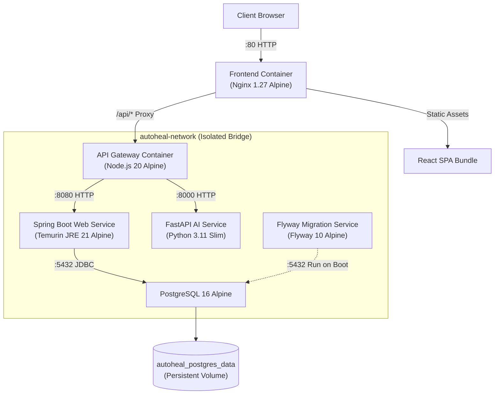
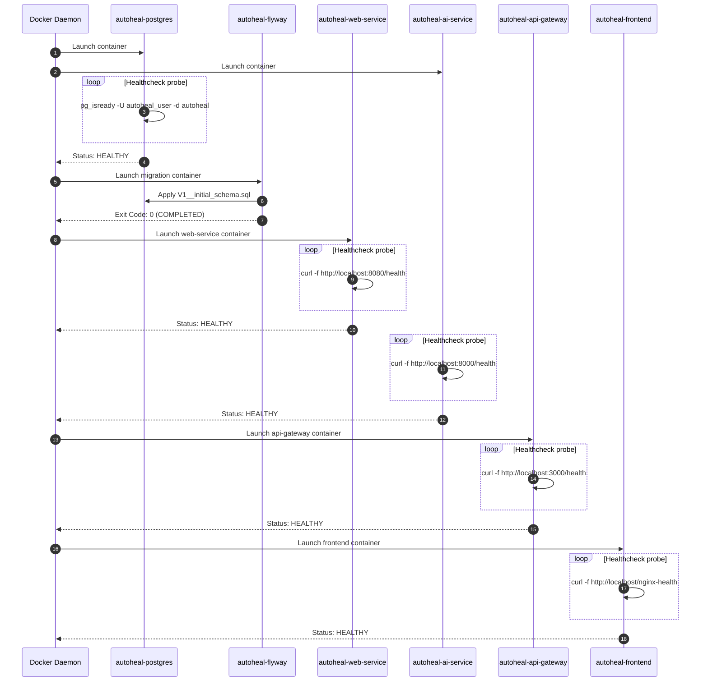

# AutoHeal AI — Infrastructure Architecture & Design Specification
**Phase 2: Containerization, Docker Compose, PostgreSQL, Database Migrations, and Reliability**  
**Document Version:** 1.0.0  
**Date:** October 2026  

---

## 1. Executive Summary

This document specifies the infrastructure and container orchestration architecture implemented for **AutoHeal AI** in Phase 2. The primary objectives achieved in this phase are:
1. **Decoupling from host environments**: Eliminating "works on my machine" issues by packaging each component into deterministic, minimal, multi-stage OCI containers.
2. **Centralized Relational Persistence**: Deploying PostgreSQL 16 with automated, version-controlled schema migrations managed by Flyway 10.
3. **Declarative Multi-Service Orchestration**: Defining a zero-downtime, health-aware startup dependency graph with Docker Compose.
4. **Resilience & Fault Isolation**: Implementing strict timeout controls, non-cascading degradation policies, and unified reverse-proxy routing.

---

## 2. System Architecture & Service Topology

---

## 3. Network Architecture & Port Allocations

All microservices communicate within a dedicated Docker bridge network (`autoheal-network`). Service resolution occurs automatically using Docker's internal DNS daemon.

| Service | Container Name | Base Image | Internal Port | Host Published Port | Purpose |
|---|---|---|---|---|---|
| **frontend** | `autoheal-frontend` | `nginx:1.27-alpine` | `80` | `80:80` | Production SPA server & API reverse proxy |
| **api-gateway** | `autoheal-api-gateway` | `node:20-alpine` | `3000` | `3000:3000` | Downstream routing, timeout isolation, CORS |
| **web-service** | `autoheal-web-service` | `eclipse-temurin:21-jre-alpine` | `8080` | `8080:8080` | Core transactional logic & metrics |
| **ai-service** | `autoheal-ai-service` | `python:3.11-slim` | `8000` | `8000:8000` | Fault diagnosis & recovery decision engine |
| **postgres** | `autoheal-postgres` | `postgres:16-alpine` | `5432` | `5432:5432` | Relational state store |
| **flyway** | `autoheal-flyway` | `flyway/flyway:10-alpine` | — | — | Transient container executing schema migrations |

---

## 4. Startup Dependency Graph & Lifecycle Management

To prevent race conditions during cold cluster boots, services employ Docker Compose health condition barriers:

---

## 5. Security & Container Hardening Controls

Each container adheres to defense-in-depth principles:

1. **Non-Root Execution**:
   - `autoheal-frontend`: Nginx Alpine default unprivileged master/worker process.
   - `autoheal-api-gateway`: Runs under system user `node` (UID 1000).
   - `autoheal-ai-service`: Runs under unprivileged user `appuser` (UID 1000).
   - `autoheal-web-service`: Runs under unprivileged user `spring` (UID 1000).
2. **Minimal Surface Footprint**:
   - Alpine Linux and Debian Slim base images.
   - Production dependency trimming (`npm ci --omit=dev`, `pip --no-cache-dir`, Maven multi-stage stripping build tooling).
3. **Secret Isolation**:
   - Credentials configured via external `.env` loaded into container environment variables.
   - `.env` excluded from version control via `.gitignore`.
   - Safe template documented in `.env.example`.
4. **Header Hardening**:
   - Nginx delivers `X-Frame-Options: DENY`, `X-Content-Type-Options: nosniff`, `X-XSS-Protection: 1; mode=block`, and strict referrer policies.

---

## 6. Fault Isolation & Timeout Management

Downstream calls from `api-gateway` to backend microservices are protected by an `AbortSignal.timeout(5000)`. If a microservice crashes, hangs, or experiences high latency:
- The gateway terminates the socket after 5,000 ms.
- Returns HTTP 503 `{"service": "<target>", "status": "DOWN", "error": "..."}`.
- Unaffected services continue servicing requests normally without cascade blockage.
