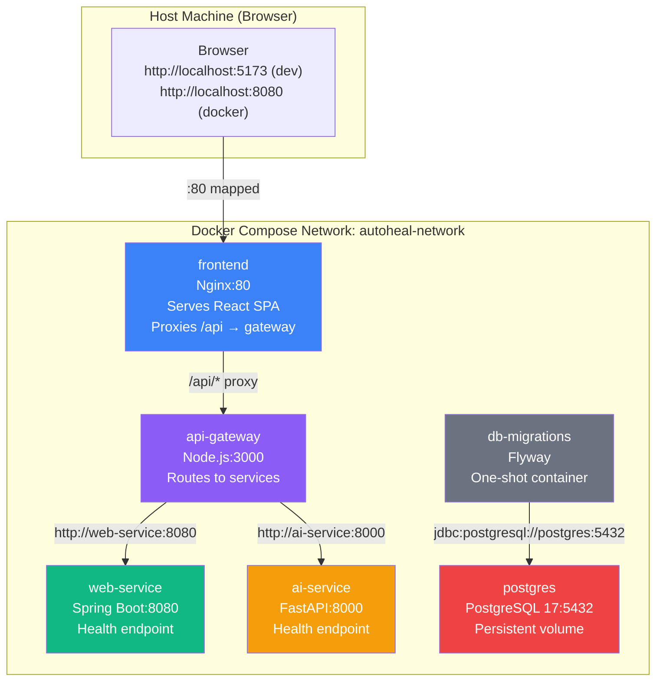

# AutoHeal AI — Phase 2 Discovery Report

**Date:** 2026-10-15  
**Stage:** 1 — Read-Only Repository Discovery (COMPLETE)  
**Status:** Awaiting approval before any file modifications

---

## 1. Repository State Summary

### Git Status
- **Working tree:** Clean — no uncommitted changes
- **Commit history (5 commits):**
  ```
  e29c9cd  Complete Phase 1 application foundation
  a23d21c  Add API gateway and React dashboard
  1b8ad24  Add Spring Boot web service health endpoint
  7774a49  Add project README
  9c2b524  Phase 1: initialize project foundation
  ```

### Verified Environment
| Tool | Version |
|---|---|
| Docker Engine | 29.5.2 |
| Docker Compose | v5.1.3 |
| Java (Temurin) | 21.0.12.1+1 LTS |
| Node.js | v24.14.1 |
| npm | 11.11.0 |
| Python | 3.12.10 |
| Spring Boot | 4.1.1 |
| Vite | ^8.3.0 |
| React | ^19.2.8 |
| Express | ^5.3.0 |
| FastAPI | 0.143.2 |
| Uvicorn | 0.54.0 |

---

## 2. What Already Exists and Works

### A. React Frontend ([`frontend/`](file:///c:/WT_EDI/AutoHeal-AI/AutoHealAI/frontend))

| File | Purpose |
|---|---|
| [`package.json`](file:///c:/WT_EDI/AutoHeal-AI/AutoHealAI/frontend/package.json) | React 19.2.8, Vite 8.3.0, ESLint |
| [`vite.config.js`](file:///c:/WT_EDI/AutoHeal-AI/AutoHealAI/frontend/vite.config.js) | Minimal — `react()` plugin only, **no proxy configured** |
| [`src/App.jsx`](file:///c:/WT_EDI/AutoHeal-AI/AutoHealAI/frontend/src/App.jsx) | Dashboard with `ServiceCard` components for Web Service, AI Service, Recovery Engine |
| [`src/App.css`](file:///c:/WT_EDI/AutoHeal-AI/AutoHealAI/frontend/src/App.css) | Simple card-based grid layout |
| [`src/index.css`](file:///c:/WT_EDI/AutoHeal-AI/AutoHealAI/frontend/src/index.css) | Vite default template CSS with dark/light theme variables |
| [`src/main.jsx`](file:///c:/WT_EDI/AutoHeal-AI/AutoHealAI/frontend/src/main.jsx) | Standard React 19 entry point |
| `package-lock.json` | Present (84.6 KB) |
| `.gitignore` | Standard Vite template |
| `public/favicon.svg` | Custom lightning-bolt SVG icon |

> [!IMPORTANT]
> **Critical finding:** The frontend uses **hardcoded absolute URLs** to the gateway:
> ```javascript
> fetch('http://localhost:3000/api/web/health')
> fetch('http://localhost:3000/api/ai/health')
> ```
> This will **not work** when the frontend is served from a Docker container, since `localhost:3000` won't resolve to the gateway container.

**Verified working:** Dashboard loads at `http://localhost:5173`, both service cards show **UP**.

### B. API Gateway ([`api-gateway/`](file:///c:/WT_EDI/AutoHeal-AI/AutoHealAI/api-gateway))

| File | Purpose |
|---|---|
| [`package.json`](file:///c:/WT_EDI/AutoHeal-AI/AutoHealAI/api-gateway/package.json) | Express 5.3.0, cors 2.8.6, nodemon 3.1.14 (dev) |
| [`server.js`](file:///c:/WT_EDI/AutoHeal-AI/AutoHealAI/api-gateway/server.js) | Gateway with 3 routes: `/health`, `/api/web/health`, `/api/ai/health` |
| `package-lock.json` | Present (42.5 KB) |

> [!WARNING]
> **Critical findings:**
> 1. **Hardcoded downstream URLs:** `http://localhost:8080` and `http://localhost:8000` — will break inside Docker (localhost = the container itself).
> 2. **No `start` script** in `package.json` — the `"main"` field says `"index.js"` but the actual file is `server.js`. Currently started manually with `node server.js`.
> 3. **Port is hardcoded:** `const PORT = 3000;` — not configurable via environment variables.
> 4. **npm audit: 3 high-severity vulnerabilities** — all in the `nodemon → chokidar → braces` chain. This is a **devDependency only** and does **not** affect production runtime.

**Verified working:** All 3 endpoints respond correctly at `http://localhost:3000`.

### C. Spring Boot Web Service ([`services/web-service/`](file:///c:/WT_EDI/AutoHeal-AI/AutoHealAI/services/web-service))

| File | Purpose |
|---|---|
| [`pom.xml`](file:///c:/WT_EDI/AutoHeal-AI/AutoHealAI/services/web-service/pom.xml) | Spring Boot 4.1.1, Java 21, `spring-boot-starter-webmvc` |
| [`WebServiceApplication.java`](file:///c:/WT_EDI/AutoHeal-AI/AutoHealAI/services/web-service/src/main/java/com/autoheal/webservice/WebServiceApplication.java) | Standard Spring Boot entry point |
| [`HealthController.java`](file:///c:/WT_EDI/AutoHeal-AI/AutoHealAI/services/web-service/src/main/java/com/autoheal/webservice/controller/HealthController.java) | `GET /health` → `{"service":"web-service","status":"UP"}` |
| [`application.properties`](file:///c:/WT_EDI/AutoHeal-AI/AutoHealAI/services/web-service/src/main/resources/application.properties) | `spring.application.name=web-service` only |
| `WebServiceApplicationTests.java` | Standard `@SpringBootTest` context-load test |
| Maven Wrapper | `mvnw`/`mvnw.cmd` present, Maven 3.10.0, Wrapper 3.3.4 |
| `.gitattributes` | Line-ending rules for `mvnw`/`.cmd` |
| `.gitignore` | Standard Spring Boot template |

**Verified working:** `GET http://localhost:8080/health` returns `{"service":"web-service","status":"UP"}`.

### D. Python AI Service ([`ai-service/`](file:///c:/WT_EDI/AutoHeal-AI/AutoHealAI/ai-service))

| File | Purpose |
|---|---|
| [`main.py`](file:///c:/WT_EDI/AutoHeal-AI/AutoHealAI/ai-service/main.py) | FastAPI app with `GET /health` |
| `.venv/` | Local virtual environment (must NOT be copied into Docker) |
| `__pycache__/` | Runtime cache |

> [!WARNING]
> **No `requirements.txt`** or any other dependency manifest file exists. The installed packages were identified from the venv's pip freeze:
> ```
> fastapi==0.143.2
> uvicorn==0.54.0
> pydantic==2.14.1
> starlette==1.8.0
> pydantic_core==2.50.1
> + transitive dependencies
> ```
> A `requirements.txt` must be created before containerization.

**Verified working:** `GET http://localhost:8000/health` returns `{"service":"ai-service","status":"UP"}`.

### E. Future Directories (All Empty)

| Directory | Status |
|---|---|
| `recovery-controller/` | Empty |
| `fault-injector/` | Empty |
| `monitoring/` | Empty |
| `database/` | Empty |
| `datasets/` | Empty |
| `experiments/` | Empty |
| `docs/` | Empty |
| `scripts/` | Empty |
| `tests/` | Empty |

### F. Root Configuration

| File | Status |
|---|---|
| [`.gitignore`](file:///c:/WT_EDI/AutoHeal-AI/AutoHealAI/.gitignore) | Comprehensive — covers `.env`, Python, Node, Java, IDE, data, ML artifacts |
| [`README.md`](file:///c:/WT_EDI/AutoHeal-AI/AutoHealAI/README.md) | Minimal — title and tagline only |
| `.env` files | **None exist anywhere in the repository** |
| Dockerfiles | **None exist** |
| `docker-compose.yml` | **Does not exist** |
| `.dockerignore` files | **None exist** |

---

## 3. What is Missing for Phase 2

| Category | Missing Item | Priority |
|---|---|---|
| **Infrastructure** | `docker-compose.yml` | Critical |
| **Infrastructure** | Dockerfiles for all 4 services | Critical |
| **Infrastructure** | `.dockerignore` files | Critical |
| **Database** | PostgreSQL configuration | Critical |
| **Database** | Migration tooling and scripts | Critical |
| **Database** | Schema design | Critical |
| **Config** | `.env.example` with environment variables | Critical |
| **Config** | Environment-variable-based service configuration | Critical |
| **Dependencies** | `ai-service/requirements.txt` | Critical |
| **Networking** | Frontend API URL strategy (proxy) | Critical |
| **Networking** | Gateway downstream URL configuration | Critical |
| **Gateway** | `start` script in package.json | Important |
| **Documentation** | All Phase 2 docs (architecture, runbook, database, completion report) | Important |
| **Testing** | Integration test scripts | Important |

---

## 4. Existing Architectural Weaknesses

### W1. Hardcoded `localhost` URLs (Blocking for Docker)
- **Frontend** `App.jsx` lines 22, 27: `http://localhost:3000/...`
- **Gateway** `server.js` lines 7-8: `http://localhost:8080`, `http://localhost:8000`
- **Gateway** `server.js` line 5: `const PORT = 3000`

These must become environment-variable-driven for Docker while maintaining local-dev defaults.

### W2. No Python Dependency Manifest
The AI service has no `requirements.txt`, `pyproject.toml`, or `Pipfile`. Docker builds need deterministic dependency installation.

### W3. Gateway package.json Inconsistencies
- `"main": "index.js"` but the actual file is `server.js`
- No `"start"` script — needs `node server.js`
- No `"engines"` field to declare compatible Node.js version

### W4. npm Audit Vulnerabilities (dev-only)
3 high-severity findings in the `nodemon → chokidar → braces` chain.
- **Impact:** Dev-only — `nodemon` is a devDependency not installed in production images.
- **Remediation:** Safe to ignore for production. The `npm audit fix --force` would downgrade nodemon to an ancient version. A better path is upgrading to `nodemon@3.2.x+` if available, or migrating to `node --watch` (built into Node 24.x).

### W5. Frontend CSS Conflicts
Both `App.css` and `index.css` define `body { margin: 0; }` and competing style strategies. `index.css` is the Vite template default with custom properties; `App.css` is the application-specific layout. This is cosmetic and not blocking, but the CSS should be consolidated.

### W6. No Health Check Timeout/Retry in Gateway
The gateway's `fetch()` calls to downstream services have no timeout. A slow or hanging downstream service will cause the gateway to hang indefinitely.

---

## 5. Dependencies and Version Conflicts

| Dependency | Version | Risk |
|---|---|---|
| Spring Boot | 4.1.1 | Requires JDK 21+. Docker base image must use Eclipse Temurin 21. |
| Express | 5.3.0 | Express 5.x is the current stable release. Compatible with Node 24.x. |
| React | 19.2.8 | Current stable. No issues. |
| Vite | 8.3.0 | Current stable. No issues. |
| FastAPI | 0.143.2 | Current stable. Compatible with Python 3.12. |
| nodemon | 3.1.14 (dev) | Source of npm audit findings. Dev-only; won't be in Docker image. |
| Maven Wrapper | 3.3.4 / Maven 3.10.0 | Compatible with Spring Boot 4.1.1. |

> [!NOTE]
> No version conflicts were found. All dependency versions are consistent and compatible with each other and the installed runtimes.

---

## 6. Risks Associated with Planned Changes

| Risk | Severity | Mitigation |
|---|---|---|
| Breaking local development while adding Docker networking | High | Use env vars with localhost defaults; add Vite dev proxy |
| Spring Boot 4.1.1 Docker image compatibility | Medium | Verify Eclipse Temurin 21 JRE image availability |
| Frontend CORS / proxy misconfiguration | Medium | Test both dev (Vite proxy) and prod (Nginx proxy) paths |
| PostgreSQL migration timing (container readiness) | Medium | Use `depends_on` with `service_healthy` condition + `pg_isready` |
| Flyway version compatibility with PostgreSQL | Low | Use latest stable Flyway; verify PostgreSQL driver compatibility |
| npm audit findings creating false security alarm | Low | Document clearly that they are dev-only |

---

## 7. Proposed Target Architecture



### Port Mapping Strategy

| Service | Container Port | Host Port | Host Access |
|---|---|---|---|
| frontend (Nginx) | 80 | 80 | Yes — primary entry point |
| api-gateway | 3000 | 3000 | Yes — for direct API testing |
| web-service | 8080 | — | No — accessed via gateway only |
| ai-service | 8000 | — | No — accessed via gateway only |
| postgres | 5432 | 127.0.0.1:5432 | Loopback only — for DBA tools |
| db-migrations | — | — | No — one-shot exit container |

### Browser-to-Gateway Communication

**Development (local, no Docker):**
- Vite dev server at `:5173` with a proxy: `/api → http://localhost:3000`
- App.jsx will call relative paths: `/api/web/health`, `/api/ai/health`

**Production (Docker):**
- Nginx at `:80` serves built React assets
- Nginx proxies `/api/* → http://api-gateway:3000`
- Same relative paths work in both environments

---

## 8. Intended File Changes

### New Files

| File | Purpose |
|---|---|
| `docker-compose.yml` | Root-level service orchestration |
| `.env.example` | Environment variable template (committed) |
| `frontend/Dockerfile` | Multi-stage: build React → Nginx serve + proxy |
| `frontend/nginx.conf` | Nginx config with SPA fallback + /api proxy |
| `frontend/.dockerignore` | Exclude node_modules, .git, etc. |
| `api-gateway/Dockerfile` | Node.js production image |
| `api-gateway/.dockerignore` | Exclude node_modules, .git, etc. |
| `services/web-service/Dockerfile` | Multi-stage: Maven build → JRE runtime |
| `services/web-service/.dockerignore` | Exclude target, .git, IDE files |
| `ai-service/Dockerfile` | Python slim image with requirements |
| `ai-service/.dockerignore` | Exclude .venv, __pycache__, .git |
| `ai-service/requirements.txt` | Pinned Python dependencies |
| `database/migrations/V1__initial_schema.sql` | Initial Flyway migration |
| `database/flyway.conf` | Flyway configuration (uses env vars for credentials) |
| `docs/phase-2-infrastructure-design.md` | Architecture documentation |
| `docs/phase-2-runbook.md` | Setup and operations guide |
| `docs/database-design.md` | Schema documentation |
| `docs/phase-2-completion-report.md` | Test results and completion evidence |

### Modified Files

| File | Change | Reason |
|---|---|---|
| `frontend/src/App.jsx` | Change hardcoded URLs to relative paths | Docker + local dev compatibility |
| `frontend/vite.config.js` | Add dev proxy for `/api` | Route API calls to gateway in dev mode |
| `api-gateway/server.js` | Read URLs and port from env vars with defaults | Docker networking compatibility |
| `api-gateway/package.json` | Add `"start"` script; fix `"main"` field | Proper container startup |
| `.gitignore` | Add `.env` patterns (already present); add Docker patterns | Prevent committing secrets |

### Explicitly NOT Changed

- No upgrades to Spring Boot, React, Express, FastAPI, or Vite versions
- No restructuring of the repository directory layout
- No changes to the health controller logic
- No new application features or recovery logic
- No monitoring, observability, or ML components

---

## 9. Database Design Recommendations

### Purpose
PostgreSQL will serve as the **operational database** for AutoHeal AI's incident lifecycle. It will store structured records of incidents detected, diagnosis results produced by the AI service, recovery actions attempted, and audit events for traceability.

### What Belongs in PostgreSQL
- Incident records (detected anomalies)
- Diagnosis results (AI-generated fault classifications)
- Recovery attempts (actions taken and their outcomes)
- Audit events (who/what triggered changes and when)
- Configuration snapshots for recovery playbooks (future)

### What Does NOT Belong in PostgreSQL
- High-volume metrics and time-series data → Prometheus/VictoriaMetrics (Phase 3+)
- Raw application logs → Log aggregator (Phase 3+)
- Distributed traces → Jaeger/Zipkin (Phase 3+)
- ML model artifacts → File/object storage (Phase 3+)
- Training datasets → File storage + versioning (Phase 3+)

### Initial Schema (Justified)

```sql
-- V1__initial_schema.sql

-- Incidents: detected anomalies in monitored services
CREATE TABLE incidents (
    id              UUID PRIMARY KEY DEFAULT gen_random_uuid(),
    service_name    VARCHAR(100)  NOT NULL,
    severity        VARCHAR(20)   NOT NULL CHECK (severity IN ('LOW','MEDIUM','HIGH','CRITICAL')),
    status          VARCHAR(20)   NOT NULL CHECK (status IN ('OPEN','DIAGNOSING','RECOVERING','RESOLVED','FAILED'))
                    DEFAULT 'OPEN',
    title           VARCHAR(500)  NOT NULL,
    description     TEXT,
    metadata        JSONB         DEFAULT '{}',
    detected_at     TIMESTAMPTZ   NOT NULL DEFAULT now(),
    resolved_at     TIMESTAMPTZ,
    created_at      TIMESTAMPTZ   NOT NULL DEFAULT now(),
    updated_at      TIMESTAMPTZ   NOT NULL DEFAULT now()
);

-- Diagnosis: AI-generated fault analysis linked to incidents
CREATE TABLE diagnoses (
    id              UUID PRIMARY KEY DEFAULT gen_random_uuid(),
    incident_id     UUID          NOT NULL REFERENCES incidents(id),
    root_cause      VARCHAR(500),
    confidence      DECIMAL(5,4)  CHECK (confidence BETWEEN 0 AND 1),
    model_version   VARCHAR(50),
    details         JSONB         DEFAULT '{}',
    created_at      TIMESTAMPTZ   NOT NULL DEFAULT now()
);

-- Recovery attempts: actions taken to resolve incidents
CREATE TABLE recovery_actions (
    id              UUID PRIMARY KEY DEFAULT gen_random_uuid(),
    incident_id     UUID          NOT NULL REFERENCES incidents(id),
    diagnosis_id    UUID          REFERENCES diagnoses(id),
    action_type     VARCHAR(100)  NOT NULL,
    status          VARCHAR(20)   NOT NULL CHECK (status IN ('PENDING','APPROVED','EXECUTING','SUCCEEDED','FAILED','ROLLED_BACK'))
                    DEFAULT 'PENDING',
    parameters      JSONB         DEFAULT '{}',
    result          JSONB         DEFAULT '{}',
    started_at      TIMESTAMPTZ,
    completed_at    TIMESTAMPTZ,
    created_at      TIMESTAMPTZ   NOT NULL DEFAULT now()
);

-- Audit trail: immutable log of all significant system events
CREATE TABLE audit_events (
    id              UUID PRIMARY KEY DEFAULT gen_random_uuid(),
    event_type      VARCHAR(100)  NOT NULL,
    actor           VARCHAR(100)  NOT NULL DEFAULT 'system',
    resource_type   VARCHAR(100),
    resource_id     UUID,
    details         JSONB         DEFAULT '{}',
    created_at      TIMESTAMPTZ   NOT NULL DEFAULT now()
);

-- Indexes for expected query patterns
CREATE INDEX idx_incidents_status ON incidents(status);
CREATE INDEX idx_incidents_service ON incidents(service_name);
CREATE INDEX idx_incidents_detected ON incidents(detected_at DESC);
CREATE INDEX idx_diagnoses_incident ON diagnoses(incident_id);
CREATE INDEX idx_recovery_incident ON recovery_actions(incident_id);
CREATE INDEX idx_recovery_status ON recovery_actions(status);
CREATE INDEX idx_audit_type ON audit_events(event_type);
CREATE INDEX idx_audit_resource ON audit_events(resource_type, resource_id);
CREATE INDEX idx_audit_created ON audit_events(created_at DESC);
```

### Design Rationale

| Decision | Reasoning |
|---|---|
| UUID primary keys | Globally unique across future distributed components; no sequence contention |
| `TIMESTAMPTZ` everywhere | Unambiguous timezone handling; all times in UTC |
| `JSONB` for metadata/details | Flexible extension without schema migration for every new field |
| CHECK constraints on status | Prevent invalid states at the database level |
| `audit_events` is append-only | Immutable audit trail — no UPDATE/DELETE expected |
| 4 tables only | Minimal justified schema; additional tables added via future migrations |

### Database Ownership
- **Single database:** `autoheal` — owned by all AutoHeal AI services
- **Initial access:** Web Service will be the primary reader/writer in Phase 3+
- **AI Service:** Will write diagnosis results in Phase 3+
- **Recovery Controller:** Will write recovery actions in Phase 4+
- **No service connects to PostgreSQL in Phase 2** — infrastructure is established and verified, but application-level integration is deferred

### Migration Tool: Flyway

**Why Flyway:**
- Industry-standard, well-documented, mature
- Native PostgreSQL support
- Simple versioned SQL files (`V1__`, `V2__`, etc.)
- Lightweight Docker image available for one-shot migration execution
- No JVM required for the migration container (uses the official Flyway Docker image)
- Tracks applied migrations in `flyway_schema_history` table
- Prevents re-application of versioned migrations
- Fails loudly on conflicts or errors

**Migration execution strategy:** Dedicated one-shot container (`db-migrations`) in Docker Compose that:
1. Waits for PostgreSQL to be healthy (`depends_on: postgres: condition: service_healthy`)
2. Runs Flyway migrate
3. Exits with code 0 on success
4. Does NOT restart after successful completion (`restart: "no"`)
5. Exits with non-zero on failure, making the problem immediately visible

---

## 10. Sequenced Implementation and Testing Plan

### Checkpoint 1 — Configuration Design
1. Create `.env.example` with all environment variables
2. Modify `api-gateway/server.js` to read env vars with defaults
3. Modify `api-gateway/package.json` to add `start` script
4. Modify `frontend/src/App.jsx` to use relative API paths
5. Modify `frontend/vite.config.js` to add dev proxy
6. **Test:** Run all services locally, verify dashboard still works

### Checkpoint 2 — Database Baseline
1. Create `database/migrations/V1__initial_schema.sql`
2. Create PostgreSQL service in `docker-compose.yml` (standalone first)
3. Create Flyway migration container configuration
4. **Test:** Start PostgreSQL + run migrations; verify tables exist; run again to verify idempotency

### Checkpoint 3 — Application Containerization
1. Create `ai-service/requirements.txt`
2. Create Dockerfiles: frontend, api-gateway, web-service, ai-service
3. Create `.dockerignore` files for each service
4. **Test:** Build each image independently; verify they start

### Checkpoint 4 — Compose Orchestration
1. Assemble complete `docker-compose.yml` with all services
2. Add health checks, dependencies, networking, volumes
3. Create `frontend/nginx.conf`
4. **Test:** `docker compose up --build`; verify all containers healthy

### Checkpoint 5 — Integration & Resilience
1. Test full request flow: browser → frontend → gateway → services
2. Test database persistence across restarts
3. Test failure scenarios (service down, DB unavailable)
4. **Test:** Document all test commands and actual results

### Checkpoint 6 — Documentation & Final Review
1. Write all 4 documentation files
2. Final end-to-end verification
3. Create phase-2 progress tracker

---

## 11. Acceptance Criteria

### Infrastructure ✅ Checklist
- [ ] Dockerfiles exist for frontend, gateway, web-service, ai-service
- [ ] All images build successfully
- [ ] `docker-compose.yml` validates (`docker compose config`)
- [ ] Stack starts with `docker compose up --build -d`
- [ ] Inter-container communication uses service DNS names
- [ ] Services report healthy/unhealthy/unavailable states
- [ ] Frontend accessible from host browser

### Database ✅ Checklist
- [ ] PostgreSQL starts and passes `pg_isready`
- [ ] Credentials configured via `.env` (not in source code)
- [ ] Named volume for persistent storage
- [ ] Flyway migrations execute successfully
- [ ] Schema documented and inspectable
- [ ] Data persists across `docker compose down` + `docker compose up`
- [ ] Second migration run is idempotent

### Application Behavior ✅ Checklist
- [ ] `GET /health` on gateway works
- [ ] `GET /api/web/health` through gateway returns web-service status
- [ ] `GET /api/ai/health` through gateway returns ai-service status
- [ ] Frontend health indicators reflect actual service responses
- [ ] Phase 1 local development still works

### Reliability & Security ✅ Checklist
- [ ] No secrets committed to Git
- [ ] Images exclude dev artifacts (.venv, node_modules, target)
- [ ] Containers run as non-root where practical
- [ ] Dependencies reviewed; unresolved vulnerabilities documented
- [ ] Failure handling tested
- [ ] No destructive operations performed

### Documentation ✅ Checklist
- [ ] `docs/phase-2-infrastructure-design.md` complete
- [ ] `docs/phase-2-runbook.md` with Windows PowerShell commands
- [ ] `docs/database-design.md` with ERD
- [ ] `docs/phase-2-completion-report.md` with actual test results
- [ ] A new developer can reproduce the setup

---

## 12. Key Architecture Decisions (Pre-Approval)

| # | Decision | Rationale |
|---|---|---|
| AD1 | Nginx for frontend production serving | Multi-stage build eliminates Node.js runtime; serves static SPA; proxies `/api` to gateway over Docker network |
| AD2 | Relative API paths in React + Vite proxy | Same code works in dev (Vite proxy) and prod (Nginx proxy); no CORS needed |
| AD3 | Environment variables with localhost defaults | Docker uses service DNS; local dev uses defaults; same code, no branching |
| AD4 | Flyway for migrations | Simple SQL files, mature tool, official Docker image, no JVM dependency in migration container |
| AD5 | One-shot migration container | Clean separation; runs once, exits; doesn't restart; visible failure |
| AD6 | PostgreSQL 17 | Current stable LTS; UUID `gen_random_uuid()` built-in; JSONB mature |
| AD7 | Single `autoheal` database | Appropriate for prototype; avoids premature database-per-service complexity |
| AD8 | No application-level DB connection in Phase 2 | Database infra established and verified; app integration deferred to Phase 3 |
| AD9 | nodemon audit finding: document, don't force-fix | Dev-only dependency; not in production image; force-fix causes worse problems |
| AD10 | Eclipse Temurin 21 JRE for Spring Boot image | Matches local JDK; official Docker images available; slim variants exist |

---

## Summary

The Phase 1 repository is in good shape: clean Git history, all 4 services functional, no uncommitted changes. The primary gaps for Phase 2 are:

1. **No containerization infrastructure** — no Dockerfiles, Compose, or `.dockerignore` files
2. **Hardcoded localhost URLs** — gateway and frontend both assume localhost
3. **No Python dependency manifest** — `requirements.txt` missing
4. **No database** — empty `database/` directory
5. **No documentation** — empty `docs/` directory

The proposed implementation addresses all gaps incrementally across 6 checkpoints, with testing at each boundary.

**Awaiting your approval to proceed with Checkpoint 1.**
